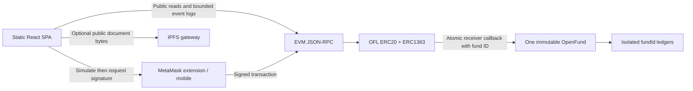

# Architecture

The wallet is required only for writes. The browser reads the configured public RPC independently. Wagmi owns the wallet connector; Viem owns typed ABI encoding, RPC calls, simulation and receipt decoding. TanStack Query caches public state and refreshes after receipts.

Every official version resolves to a configured chain ID, OpenFund address, OFL address, deployment block and hash. The app checks chain ID, deployment block hash and deployed code before reads or writes. URL values never choose an arbitrary contract. Version keys must be globally unique; fund IDs are unique within a deployment only.

OpenFund holds OFL for all funds while maintaining isolated balances, lifetime totals and a running global liability counter. It contains no platform role or external execution hook. Only the immutable token may enter its donation callback. Token movement and ledger credit revert together.

Fund discovery pages fetch 12 IDs at a time, reading four funds concurrently. Activity scans process 2,000-block windows, subdivide restrictive ranges, expose progress/cancel/retry and validate cached window hashes. Search covers loaded records. Logs identify wallet donation and membership candidates; current permissions and refund amounts are then re-read from the contract. There is no server index.

Presentation metadata, report files and availability are separate from immutable funding rules. Report commitments use keccak256 of exact document bytes; rendering never executes remote HTML. A content hash proves integrity, not real-world truth.

Browser configuration lives in `app/src/config.ts`, with Vite validating settings and deployment selection before serving or building. CLI configuration lives in `scripts/config.mjs`; it loads the ignored root `.env` once and preserves shell overrides. Local development works without configuration. Imported manifests supply chain identity, endpoints and currency; UI state selects the IPFS upload provider. Required remote endpoints, chain identity and signer credentials remain explicit.
